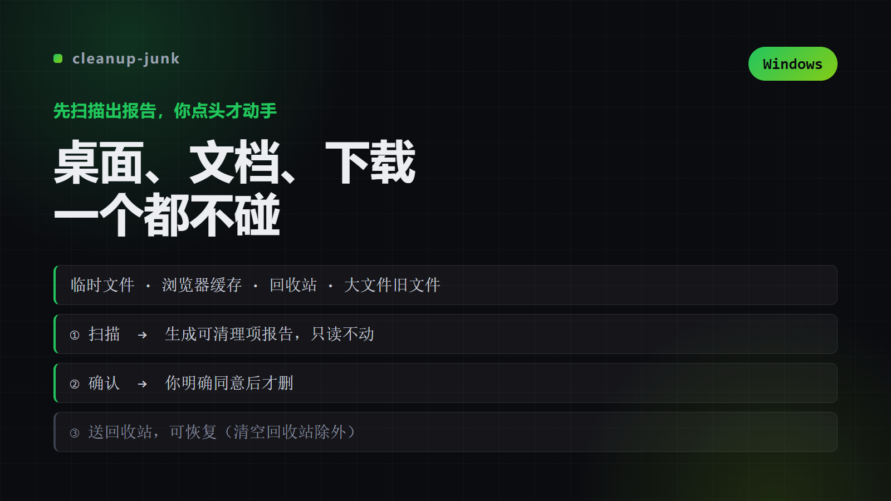

# cleanup-junk

"Windows 电脑垃圾清理助手。当用户要求清理电脑垃圾、清缓存、释放C盘空间、清理临时文件、清回收站或扫描大文件时使用。该 skill 采用先扫描报告、再确认清理的两阶段流程，默认只读取并生成可清理项报告，删除动作在用户明确确认后才执行，且临时文件与浏览器缓存一律送入回收站（可恢复），绝不触碰桌面、文档、下载等个人目录。仅支持 Windows。"

## 📺 看看效果



> 把 `screenshots/hero.png` 换成真实效果图（建议 1200px 宽、不超过 400KB）

## What This Does

"Windows 电脑垃圾清理助手。当用户要求清理电脑垃圾、清缓存、释放C盘空间、清理临时文件、清回收站或扫描大文件时使用。该 skill 采用先扫描报告、再确认清理的两阶段流程，默认只读取并生成可清理项报告，删除动作在用户明确确认后才执行，且临时文件与浏览器缓存一律送入回收站（可恢复），绝不触碰桌面、文档、下载等个人目录。仅支持 Windows。"

### Key Features

- Overview
- When to Use
- Workflow（两阶段）
- 阶段 0：确认范围（必要时）
- 阶段 1：扫描并报告（始终只读）
- 阶段 2：确认后清理
- 用户说“清理电脑垃圾”“清一下 C 盘”“清理临时文件/缓存”“清空回收站”“释放磁盘空间”。
- 用户要求“扫描大文件 / 找占空间的文件 / 看看哪些文件很久没动”。

## Installation

### WorkBuddy

```bash
git clone https://github.com/<you>/cleanup-junk.git ~/.workbuddy-ai/skills/cleanup-junk
pip install -r ~/.workbuddy-ai/skills/cleanup-junk/requirements.txt
```

### Claude Code / 其他 Agent

```bash
mkdir -p ~/.claude/skills/cleanup-junk
cp -R SKILL.md README.md requirements.txt scripts references \
      ~/.claude/skills/cleanup-junk/
```

把仓库链接丢给 agent，它会按 `SKILL.md` 加载所需文件。

## Usage

在支持 Agent Skills 的客户端里提到「**cleanup-junk**」即可触发；也可用该客户端的 Skill 调用命令显式加载。

## Architecture

| 文件 | 作用 |
|---|---|

## Requirements

- Python 3.9+
- `pip install -r requirements.txt`

## Credits

Created by 公子 · [@你的GitHub](https://github.com/).

## License

MIT — Use it, modify it, share it.
